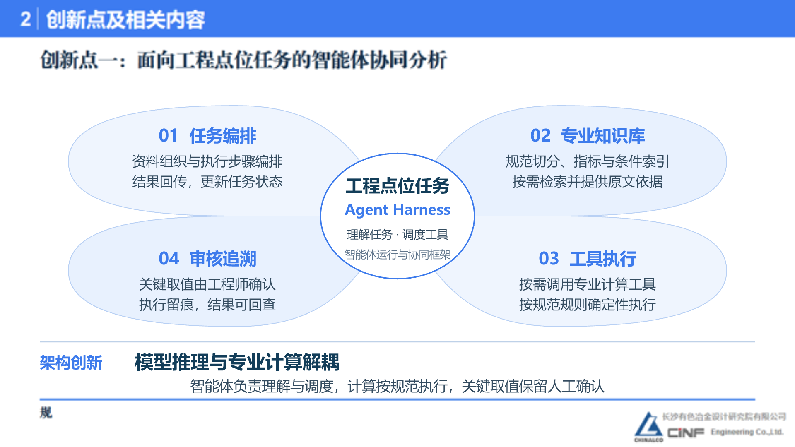
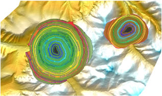

# 岩体质量分级工作流程与工作量_终版2

- Source: `岩体质量分级工作流程与工作量_终版2.pptx`
- Total slides: 1

## Slide 1

1 | 项目背景及思路

岩体质量分级：现有流程与人工工作量

现有评价流程

同一点位按不同方法分别整理参数、查表取值与计算校核

01

02

03

04

05

工程资料

指标整理

规范取值

计算校核

成果编制

岩芯编录等资料

提取评价指标

按方法查表定参

按评分规则复核

汇编计算书

典型矿山项目

25

500

5

≈20

工程部位

测点

种方法 / 点位

分钟 / 方法

人工估算总量

估算口径

≈ 833

500点 × 5种方法

人时

× 20分钟 ÷ 60

≈ 833 人时

典型矿山工程场景示意

工作量判断

工作量不止公式计算：多部位、多点位、多方法下的资料整理、参数录入和成果编制同样耗时。

资料、取值依据与计算结果分散在不同表格和文档中，增加成果校审工作量，也让复核难以快速追溯来源和过程。

### Speaker Notes

工作量估算依据用户提供的讲稿：典型矿山项目统计25个工程部位、500个测点，每个点位根据工程要求采用5种岩体质量分级或评价方法，单种方法平均约20分钟。估算为500×5×20÷60≈833人时。不同方法的指标体系和评分规则存在差异，需要按方法整理参数、查阅规范并分别计算。左侧图片只作工程场景示意，不承载项目数据。
