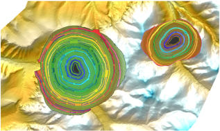

# 岩体质量分级工作流程与工作量_案例版

- Source: `岩体质量分级工作流程与工作量_案例版.pptx`
- Total slides: 1

## Slide 1

1 | 项目背景及思路

不同评价方法的指标体系与评分规则各异，参数取值、计算与校核需按方法分别开展。

多方法岩体质量评价的工作量与校审难点

现有评价流程

从资料整理到成果编制，参数与计算按方法分别处理

01

02

03

04

05

工程资料

指标整理

规范取值

计算校核

成果编制

岩芯编录等资料

提取评价指标

按方法查表定参

按评分规则复核

汇编计算书

典型矿山项目统计

25

500

5

≈20

工程部位

测点

种方法 / 点位

分钟 / 方法

人工估算总量

估算口径

≈ 833

500测点 × 5种方法

人时

× 20分钟 ÷ 60

折合约 833 人时

典型矿山工程场景示意

工作量不止公式计算：多部位、多点位、多方法下的资料整理、参数录入与成果编制同样耗时；资料、取值依据和结果分散于不同表格与文档，增加校审成本，也使结果来源与计算过程难以快速追溯。

