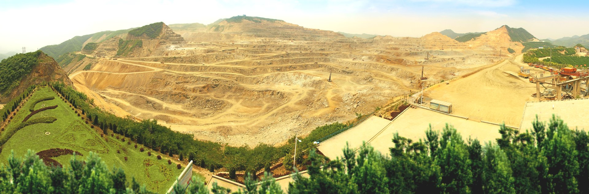

# 岩体质量分级工作流程与工作量_页面调整版2

- Source: `岩体质量分级工作流程与工作量_页面调整版2.pptx`
- Total slides: 1

## Slide 1

1 | 项目背景及思路

不同方法的指标与评分规则各异，需分别定参、计算和校核，多部位、多点位作业带来较大工作量。

现有问题

01

02

03

04

05

工程资料

指标整理

规范取值

计算校核

成果编制

整理岩芯编录等资料

提取评价指标

查阅规范、确定参数

按方法计算并校核

汇编计算书

典型矿山项目统计

25

500

5

≈20

工程部位

测点

种方法 / 点位

分钟 / 方法

人工估算工作量

≈ 833 人时

500 × 5 × 20 ÷ 60

分级计算与成果编制

工作量不仅来自公式计算，还包括多部位、多点位、多方法下的资料整理、参数录入与成果编制。资料、取值依据和计算结果分散在不同表格与文档中，增加校审工作量，也使结果来源和计算过程难以快速追溯。

### Speaker Notes

岩体质量分级流程包括工程资料整理、评价指标提取、查阅规范确定参数、计算校核和成果编制。不同方法的指标体系和评分规则存在差异，参数取值、计算和校核通常需按方法分别开展。工作量估算依据用户提供的典型矿山项目统计口径：25个工程部位、500个测点、每个点位采用5种方法、单种方法平均约20分钟，计算为500×5×20÷60≈833人时。
