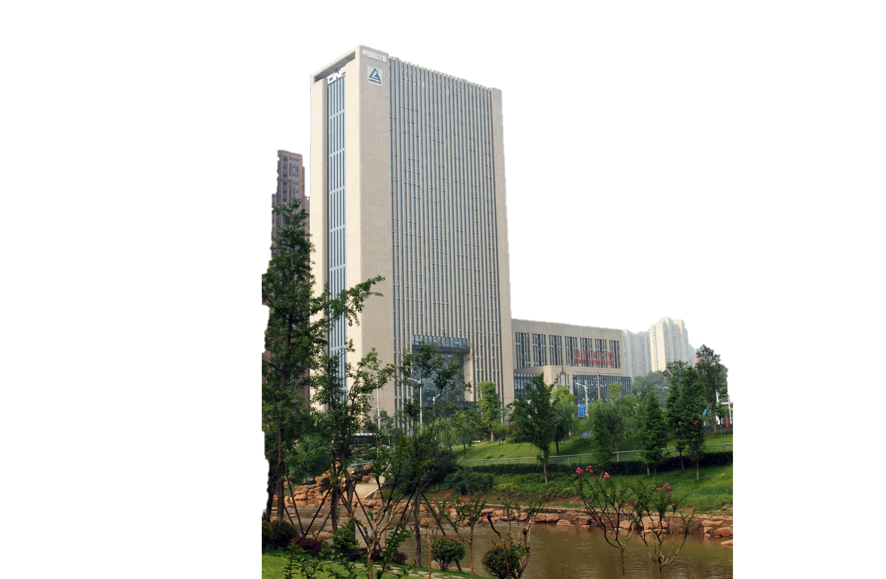
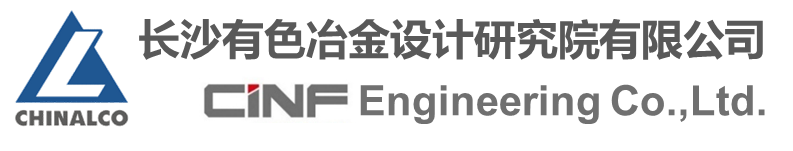
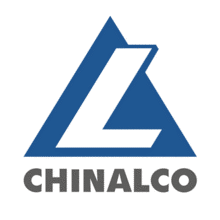
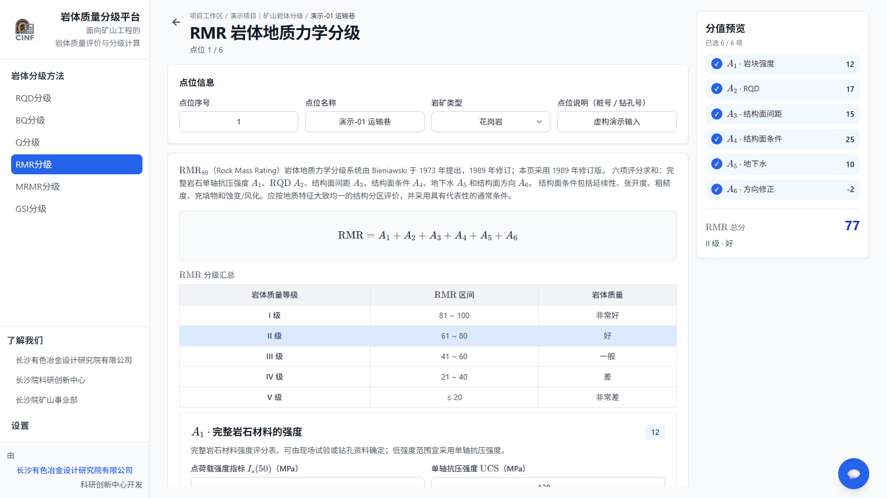

# presentation_zh

- Source: `presentation_zh.pptx`
- Total slides: 14

## Slide 1

长沙有色冶金设计研究院有限公司

科研创新中心

矿山岩体质量分级智能化系统
研发与应用

完成单位：长沙有色冶金设计研究院有限公司

汇报人：[姓名] 2026年10月

致力于成为世界一流的矿山和重有色冶金领域的综合解决方案服务商

### Speaker Notes

口述（约5秒）：各位专家、领导，大家好。我汇报的题目是《矿山岩体质量分级智能化系统研发与应用》。正式汇报前补入汇报人姓名。

## Slide 2

目录

项目背景及思路

1

2

核心创新点

3

应用效益与推广

### Speaker Notes

口述（约5秒）：本次汇报分为三部分：项目背景及思路、核心创新点、应用效益与推广。

## Slide 3

1

项目背景及思路

### Speaker Notes

章节过渡（约2秒）：先看工程现场的问题。

## Slide 4

01 项目背景及思路

多部位、多点位分级，工作量集中在重复整理与复核

[工程部位数]

[点位总数]

[方法数]

[成果组数]

个工程部位

个测点/编录点

类评价方法

组点位成果

常规作业流程

地质编录

→

指标取值

→

规范查表 / Excel

→

逐点分级

→

报告与复核

重复录入 · 多方法口径分散 · 参数依据难追 · 校审需跨表核对

主要难点

金龙项目：以上数据直接与页面图表一致；口述只强调点位规模和成果数量。

04

来源：项目方提供的西藏金龙项目统计口径；方括号数据待脱敏核实。

### Speaker Notes

口述（约25秒）：以西藏金龙矿山项目为例，本次纳入统计的工作涉及[工程部位数]个工程部位、[点位总数]个点位，采用[方法数]类评价方法，形成[成果组数]组点位成果。常规流程要从地质编录和指标取值开始，分别查规范、用Excel计算，再汇总报告。工作量不仅是公式计算，也包括重复录入和跨表复核。正式汇报时只读页面上的核心数字，不展开全部统计口径。

## Slide 5

01 项目背景及思路

以点位为核心，连接分级计算工作流与智能体能力

工程与点位

参数与资料

规则计算

→

→

建立工程位置和编录点

记录原始输入和采用值

执行选定分级方法

依据留痕 → 计算书输出

本地智能体接入：专业知识问答 · 点位上下文分析 · 视觉识别

固定规则负责参数校验与确定性计算；智能体面向具体工程任务提供知识和图像分析。

软件计算界面（虚构演示点位）

工程 / 部位 / 点位 / 原始参数 / 采用口径 / 方法与标准 / 结果 / 成果文件

05

来源：软件界面为仓库现有运行截图，点位数据为虚构演示输入。

### Speaker Notes

口述（约20秒）：我们的解决思路是把工程、点位、参数、规则和成果组织到同一工作流。规则引擎负责多方法确定性计算；智能体围绕工程师当前任务，调用知识和视觉能力，形成解释或候选建议。相关记录再进入点位成果和计算书。右侧截图是虚构演示输入，不是金龙项目成果。

## Slide 6

2

核心创新点

### Speaker Notes

章节过渡（约2秒）：下面介绍两项核心创新。

## Slide 7

02 核心创新点

架构示意 · 运行演示待补

创新点一：面向工程点位的智能体运行与协同框架

任务上下文

工程 · 部位 · 点位 · 方法 · 已录参数

智能体运行与协同层

粘贴智能体运行截图

上下文组织 → 能力调度 → 输出约束

知识问答 / 当前点位上下文 / 引用依据

专业能力

规范与院内经验知识库 · 点位上下文分析 · 视觉识别工具

智能建议经工程师审核后进入点位成果

计算公式由规则引擎执行；智能体负责理解任务、组织知识与工具调用、解释结果。

07

来源：项目方提供的智能体设计说明；本地模型调用与上下文实现见 backend/assistant_api.py。

### Speaker Notes

口述（约60秒）：第一项创新是面向点位任务的智能体运行与协同框架。智能体获得当前工程、部位、点位、方法和参数上下文，再结合规范与院内专家经验知识，对方法、参数和取值依据进行检索解释；需要时调用相应分析能力，返回带依据的解释或参数建议。固定校验与分级计算仍由规则引擎执行，最终由工程师确认。右侧补真实运行截图，最好展示当前点位上下文、知识依据和结果如何关联。仓库已经具备本地模型调用及文本知识/页面上下文注入基础；正式对外前应以可复查演示确认工具调度与结果回写范围。

## Slide 8

02 核心创新点

流程示意 · 识别结果待实测

创新点二：多模态视觉分析融入岩体评价流程

视觉分析

特征与依据

粘贴现场图像

粘贴识别结果

→

→

使用实际采集的工程图像

候选参数、特征依据或智能体解释

图像输入

工程师确认

点位记录与分级计算

图像识别为参数判断提供现场信息和可核对依据；最终采用值由工程师结合工程条件确认。

08

来源：项目方提供的目标能力描述；仓库未验证完整视觉链路，实测素材待补。

### Speaker Notes

口述（约45秒）：第二项创新是将视觉感知纳入岩体质量分级。图像不止生成一个孤立标签，而是与当前工程和点位关联，形成可供工程师核对的识别特征和参数候选，再进入分级计算和成果记录。请用真实采集图像、真实识别界面和可解释依据替换两个预留框，不填虚构准确率或未经验证的工程结论。

## Slide 9

03 知识产权与成果

知识产权成果（一）：软件著作权

粘贴软件著作权证书

粘贴软件著作权证书

扫描件或清晰照片；保持证书信息完整

可展示第二项核心软件登记成果

软件名称：[待填] 登记号：[待填] 权利人：[待填] 登记日期：[待填]

无已登记成果时，删除对应证书框；不得以产品截图代替证书。

09

展示模板：请仅放入已取得的证书或正式受理文件，并按实际状态标注。

### Speaker Notes

备查展示页（约3秒）：此页预留软件著作权证书。正式汇报前填入真实软件名称、登记号、权利人及日期；没有取得的登记成果不要展示为已授权。

## Slide 10

03 知识产权与成果

知识产权成果（二）：专利与技术成果

粘贴专利证书或受理文件

粘贴专利或成果证明

明确标注发明 / 实用新型及授权 / 受理状态

可替换为第二项专利或正式成果材料

成果名称：[待填] 专利号/申请号：[待填] 状态：[待填] 完成人：[待填]

如当前尚未取得授权，可标注“申请中/受理中”，勿表述为已授权专利。

10

展示模板：专利状态与成果名称由项目方提供正式材料后填写。

### Speaker Notes

备查展示页（约3秒）：此页预留专利或正式技术成果证明。应按实际法律状态填写，区分已授权与申请/受理中；没有对应材料时删除本页或空框。

## Slide 11

3

应用效益与推广

### Speaker Notes

章节过渡（约2秒）：最后汇报应用效益与产品化路径。

## Slide 12

04 应用效益与推广

应用效益：用同口径工时与复核指标验证

计算与成果编制工时

复核与知识沉淀

人工方式

软件方式

依据完整率

[百分比]%

[人工总工时] 小时

[软件总工时] 小时

→

经审核知识条目

[条目数] 条

节省 [节省工时] 小时 · 工时下降 [实测比例]% · 年化人力价值 [金额] 万元

同批点位 · 同一评价方法 · 同一成果要求

依据完整率 = 可回溯原始输入、采用值、方法和标准依据的抽检点位数 ÷ 抽检点位总数

12

来源：项目方金龙工程统计待补；工时和完整率均为待填实测数据。

### Speaker Notes

口述（约40秒）：应用效益分三方面。时间方面，金龙项目人工完成全部点位分级和编书用时[人工总工时]小时，软件后为[软件总工时]小时，减少[节省工时]小时。须按同一批点位、同一方法和同一成果要求对比。复核方面，点位原始资料、采用参数、方法和标准依据可以关联查询；按页面公式抽查依据完整率。知识方面，统计经专家审核的知识条目，逐步沉淀院内经验。没有实测数据时，不报告效率百分比或现金节约额。

## Slide 13

04 应用效益与推广

应用场景与产品化：以院内示范带动专业软件推广

应用场景

可拓展领域

院内矿山项目

矿山 · 交通隧道 · 地下工程 · 边坡

约 1.5 亿元

具体方法和适用条件按工程类型与现行标准核验。

项目合同额场景基础

（统计口径 / 截至日期待核实）

拟定产品价格

基础软件 50 万元/套 + AI 智能体 50 万元/套

完整配置 100 万元/套 · 首年免维护 · 次年起维护费为授权总额的10%（10万元/套·年）

首年 [销售套数] 套 → 授权收入约 [金额] 万元 | AI智能体前期研发投入约 [金额] 万元

专业知识与工程经验持续沉淀，推动工程设计数字化和人工智能专业化应用。

13

来源：约1.5亿元场景规模及价格模式为项目方提供的内部测算，需核验口径并履行审批。

### Speaker Notes

口述（约55秒）：应用可先从长沙院现有矿山项目切入，相关合同额约1.5亿元，作为院内示范场景基础；后续可拓展至交通隧道、地下工程和边坡，具体方法需按工程条件核验。商业模式拟为基础软件50万元/套、AI智能体50万元/套，完整配置100万元/套；首年免维护，第二年起按授权额10%收取，即10万元/套·年。按首年销售[销售套数]套估算授权收入[金额]万元，AI前期研发投入[金额]万元。合同额只是应用场景规模，不是软件销售收入；价格是拟定方案，净收益还须扣除交付、售后和维护成本。项目通过专业知识和工程经验沉淀，服务设计数字化升级和AI专业化应用。

## Slide 14

感谢各位领导、专家聆听，恳请批评指正

打造国际一流的科技型工程公司

打造国内领先的科技型工程公司

### Speaker Notes

口述（约5秒）：我的汇报完毕，感谢各位领导、专家聆听，恳请批评指正。
