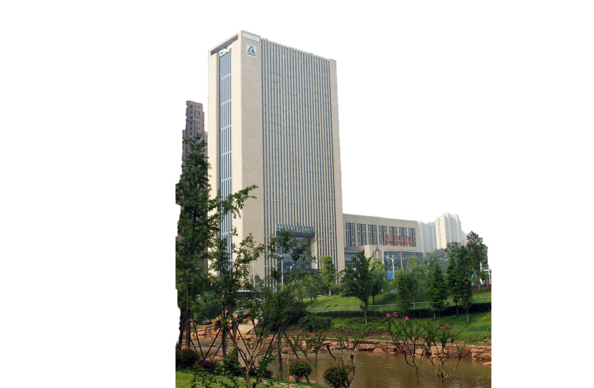

# 参考

- Source: `参考.pptx`
- Total slides: 6

## Slide 1

长沙有色冶金设计研究院有限公司

科研创新中心

铜冶炼富氧侧吹炉

多约束配料计算、炉型设计与流场仿真

关键技术及应用研究

致力于成为世界一流的矿山和重有色冶金领域的综合解决方案服务商

## Slide 2

目录

项目背景及思路

1

2

创新点及相关内容

3

应用及经济社会效益

## Slide 3

1

项目背景及思路

## Slide 4

2

创新点及相关内容

## Slide 5

3

应用及经济社会效益

## Slide 6

谢谢各位专家 敬请指正

打造国际一流的科技型工程公司

打造国内领先的科技型工程公司

